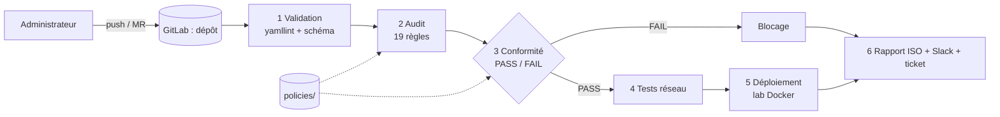

# 4. Architecture et choix de conception

## 4.1 Traçabilité exigences → implémentation
| Exigence | Réalisation |
|---|---|
| BF1 Gestion des configs | `configs/` + Git |
| BF2 Validation syntaxique | `yamllint`, `schemas/device.schema.json`, `scripts/validate.py` |
| BF3 Audit | `scripts/security_check.py` : Telnet/FTP/HTTP, SSH, ANY→ANY, ports dangereux, source non restreinte, protocoles obsolètes, zone sensible, journalisation, secrets en clair |
| BF4 Conformité | `policies/security-policy.yml` + `scripts/compliance.py` |
| BF5 Décision | exit code de `compliance.py` ; un job en échec bloque les stages suivants |
| BF6 Rapport | `report.md` (règle, configuration, gravité, raison, recommandation, ISO) |
| BF7 Historique | Git + métadonnées commit/auteur/pipeline dans `report.json` |
| BNF1 Sécurité | blocage + refus de déploiement si verdict ≠ PASSED ou empreinte modifiée |
| BNF2 Performance | 1 VM, conteneurs Alpine minimaux, outils légers (pas de GitLab ni Jenkins local) |
| BNF3 Fiabilité | tri déterministe, empreinte SHA-256, dépendances épinglées, ML exclu de la décision |
| BNF5 Maintenabilité | règles dans un YAML séparé du code et des configs |
| BNF6 Portabilité | Python + Docker ; `run_local.sh` à adapter sous Windows (WSL ou Git Bash) |

## 4.2 Règles et contrôles ISO/IEC 27001:2022 (Annexe A)
| Règle | Gravité | Contrôle |
|---|---|---|
| NET-001/002/003 Telnet, FTP, HTTP admin | HIGH | A.8.21 |
| NET-004 SSH depuis 0.0.0.0/0 · NET-008 ANY→ANY · NET-009 ports dangereux · NET-010 source non restreinte · SW-001 ports inutilisés | CRITICAL/HIGH/MEDIUM | A.8.20 |
| NET-005/006 SSH sans source / trop large | HIGH | A.5.15 |
| NET-011 zone sensible · SW-002 VLAN natif 1 | CRITICAL/MEDIUM | A.8.22 |
| NET-007 SSH v1 · NET-012 SNMP v1/v2c · NET-013 RIP v1 | HIGH/MEDIUM | A.8.24 |
| SEC-001 secret en clair | CRITICAL | A.5.17 |
| LOG-001/002 journalisation | MEDIUM/LOW | A.8.15 |
| CFG-001 timeout SSH | MEDIUM | *non défini : suggéré par le ML (A.8.9)* |

La sévérité LOW ne bloque pas (avertissement) ; CRITICAL, HIGH et MEDIUM bloquent (`decision.blocking_severities`).

## 4.3 Couche ML : rôle et limites
* **Rôle** : (1) proposer un contrôle ISO pour un constat dont la règle n'en définit pas, (2) proposer une gravité, (3) alimenter le rapport. Jamais la décision.
* **Modèle** : TF-IDF (n-grammes de caractères) + régression logistique (scikit-learn), CPU, entraînement ≈ 3 s, graine fixée.
* **Données** : 960 lignes **synthétiques**, rédigées à la main puis combinées avec des noms d'équipements. Évaluation sur des formulations **jamais vues** (2 gabarits sur 10 par classe réservés au test) : exactitude **0,94** (contrôle ISO) et **0,78** (gravité).
* **À dire honnêtement au jury** : le jeu est petit et écrit par l'auteur ; la « cohérence modèle/règles » de 100 % affichée dans le rapport est optimiste car les titres des règles ressemblent aux données d'entraînement. Pour améliorer : enrichir `ml/make_dataset.py` avec de vrais constats (CIS Benchmarks, sorties Gitleaks), évaluer par validation croisée groupée, ajouter une matrice de confusion dans le rapport final.
* **Reproductibilité** : `ml/train.py` est relancé par le pipeline avant chaque rapport (évite les incompatibilités de version de modèle sérialisé).

## 4.4 Décisions de conception (écarts avec le cahier des charges)
| Cahier des charges | Choix | Raison |
|---|---|---|
| GitHub Actions | GitLab CI | Groupe/équipe GitLab demandés |
| Checkov | Moteur Python + politique YAML | Checkov cible Terraform/K8s, pas un YAML réseau maison |
| Ansible-lint | yamllint + schéma JSON | Pas de playbooks dans la version de base |
| Batfish (optionnel) | `flow_test.py` | Batfish exige des configs Cisco/Juniper natives |
| GNS3 | Lab Docker Compose | Pas de virtualisation imbriquée, quelques Mo de RAM par conteneur |
| TheHive | Ticket GitLab via API | TheHive est lourd (Elasticsearch/Cassandra) ; reste possible en extension |

## 4.5 Perspectives (section 15 du cahier des charges)
Ansible pour le déploiement réel · Batfish avec configs Cisco · OPA/Rego (via Conftest) · détection de *drift* (job planifié comparant le lab au dépôt) · tableau de bord · enrichissement du jeu de données ML.
